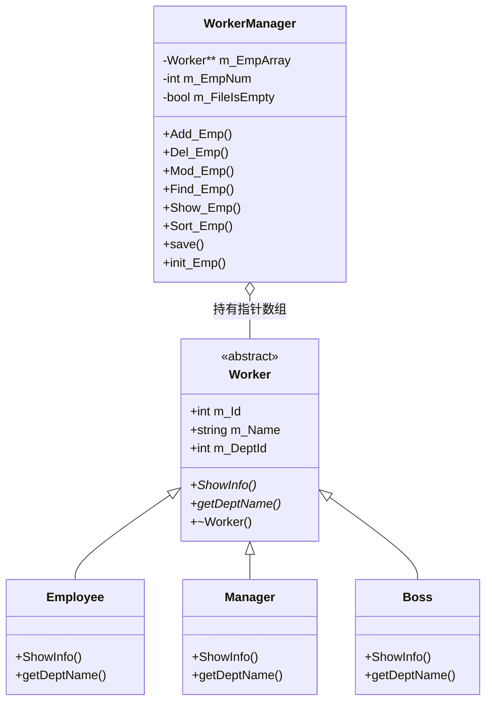

# 职工管理系统（C++ 控制台版）

大一个人学习项目：用 C++ 实现一个带增删改查的职工管理系统，用来练习面向对象、多态和文件持久化。
目前正在把它迁移到 Qt 6 图形界面，代码在 [`qt` 分支](../../tree/qt)。

> 说明：控制台版是参考入门教程实现的，重点在理解设计而不是堆功能；Qt 版是自学的，还在推进中。
> 这个仓库更像一份"学习记录"，所以下面除了功能，也写了设计思路、踩过的坑和已知不足。

## 功能

- 添加职工（普通职工 / 经理 / 老板 三类）
- 显示全部职工
- 按编号删除、修改、查找
- 按职工号升序 / 降序排序（手写选择排序）
- 数据保存到 `empFile.txt`，下次启动自动恢复

## 技术点

| 技术点 | 用在哪 |
| --- | --- |
| 抽象类 + 纯虚函数 | `Worker` 定义接口，三个派生类各自实现 `ShowInfo` / `getDeptName` |
| 虚析构函数 | `virtual ~Worker()`，保证通过基类指针删除派生类对象时能正确析构 |
| 多态 | `Worker** m_EmpArray` 存基类指针，运行时调用到派生类实现 |
| 文件流 | `ifstream` / `ofstream` 读写 `empFile.txt` |
| 动态数组 | 添加职工时重新分配 `Worker*` 数组并迁移旧数据 |

## 类设计

## 几个关键设计

**为什么用 `Worker**` 而不是 `Worker[]`**
三个派生类对象大小不同，按值放进同一个数组会发生"对象切片"，派生类的部分被切掉。所以数组里存的必须是指针，指向各自的派生类对象；通过基类指针调用虚函数，才能走到派生类的实现。

**为什么析构函数要是 `virtual`**
`delete m_EmpArray[i]` 时，编译器看到的是 `Worker*`。如果 `~Worker()` 不是虚函数，就只会调用基类析构，派生类的析构不执行，派生类里的资源不会被释放，属于未定义行为。加上 `virtual` 后，删除时会先执行派生类析构、再执行基类析构。

**扩容时为什么只 `delete[]` 旧数组、不删除对象**
`Add_Emp()` 的做法是：新建一个更大的 `Worker*` 数组 → 把旧数组里的**指针**拷贝过去 → `delete[]` 旧数组。这里释放的只是"指针表"本身，对象仍被新数组引用着，所以不能 `delete` 里面的对象，否则数据就没了。

**删除时为什么先 `delete` 再前移**
`Del_Emp()` 必须先 `delete m_EmpArray[index]`（释放这个对象），再把后面的元素整体前移一位。如果顺序反过来，前移会覆盖掉要删的指针，那个对象就再也没人引用，直接内存泄漏。

**为什么读两遍文件**
`get_EmpNum()` 先统计行数，才知道要给数组开多大；`init_Emp()` 再读一遍填充数据。这是为了配合"固定大小数组"的写法。如果用 `std::vector`，一遍 `push_back` 就够了。

## 构建与运行

用 Visual Studio 打开 `职工管理系统.slnx`，选择 `x64`，按 `F5` 运行。
程序启动后在控制台菜单里输入数字选择操作；数据保存在同目录的 `empFile.txt`。

## 踩坑记录

**1. 数据文件格式的限制**
`empFile.txt` 每行是 `编号 姓名 部门号`，用空格分隔。因为用 `>>` 读取，**姓名里不能有空格**，否则会被拆成两个字段导致整行错位。以后换成 SQLite 就没有这个问题。

**2. Qt 版在 Visual Studio 里全项目报错**
Qt 版打开后，所有文件都提示"无法打开源文件"，`#include <iostream>` 都画红线。查下来是 Qt 的 VS 扩展自动生成的 `CMakeUserPresets.json` 和项目里的 `CMakePresets.json` 定义了同名的 `Qt` 预设，CMake 报 `Duplicate preset: "Qt"` 之后干脆不读预设了，VS 的 IntelliSense 就失去了所有包含路径。
排查过程：先怀疑 Qt 路径 / 编译器配置 → 试了不同版本的 CMake（3.31 一样报错）→ 发现删掉某个文件后几秒内它又自己出现 → 用 Sysinternals 的 `handle64` 确认是 Visual Studio 进程在写这个文件。
解决办法：把 `CMakeUserPresets.json` 清成空预设并设为只读，阻止扩展再改写。

## 已知不足与下一步

**现在的问题（诚实版）**

- 输入没有做校验：`cin >>` 输入字母会让流进入失败状态，菜单会疯狂刷屏
- 内存管理是裸 `new` / `delete`，容易漏；应该用 `std::vector<std::unique_ptr<Worker>>`
- 排序是手写选择排序，可以直接用 `std::sort` + lambda
- `m_FileIsEmpty` 这个状态标志在多处维护，容易和实际情况不同步
- 没有单元测试

**路线图**

- [ ] 把 `Worker**` 重构为 `std::vector<std::unique_ptr<Worker>>`
- [ ] 加输入校验，处理 `cin` 失败
- [ ] 排序换成 `std::sort`
- [ ] Qt 版补齐增删改查界面
- [ ] 存储换 SQLite（Qt 的 `QtSql` 模块）
- [ ] 加单元测试

## 学习方式

C++ 部分跟着入门教程写，一边写一边改注释、补虚析构这种教程里容易一带而过的点；
Qt 部分靠自己查文档 + 问 AI，界面部分还在学。
这个 README 里的"关键设计"是事后自己重新理解的，如果哪里讲得不对，欢迎指出。
